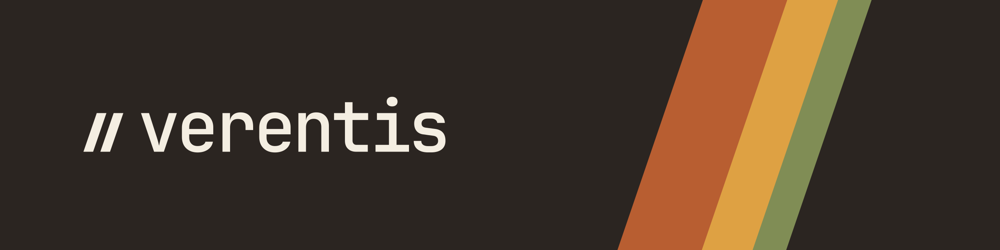

Verentis is a workspace platform for installable applications, execution engines, and reusable content.

## Open source apps

Some of our apps are open source, and you are welcome to clone them and build whole new apps of your own.
[**apps**](https://github.com/verentis/apps) includes a smart editor, Excalidraw, a Markdown viewer, a CRM and
accounting, and [**office**](https://github.com/verentis/office) brings document editing to workspaces, built on
Collabora Online. Each repository explains how to run, change and publish an app.
